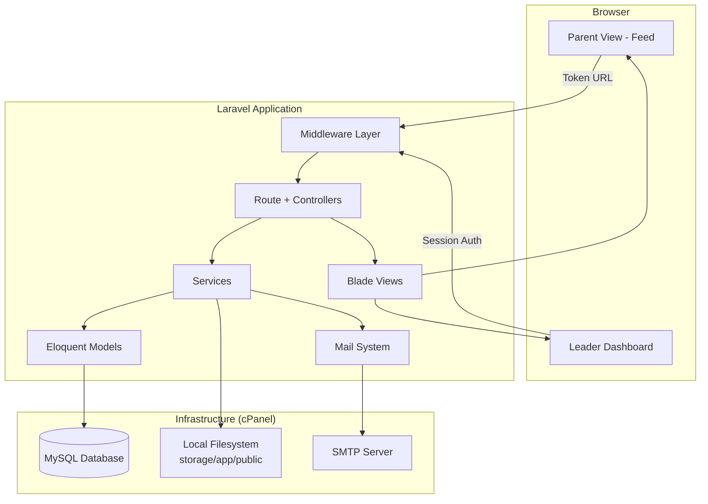
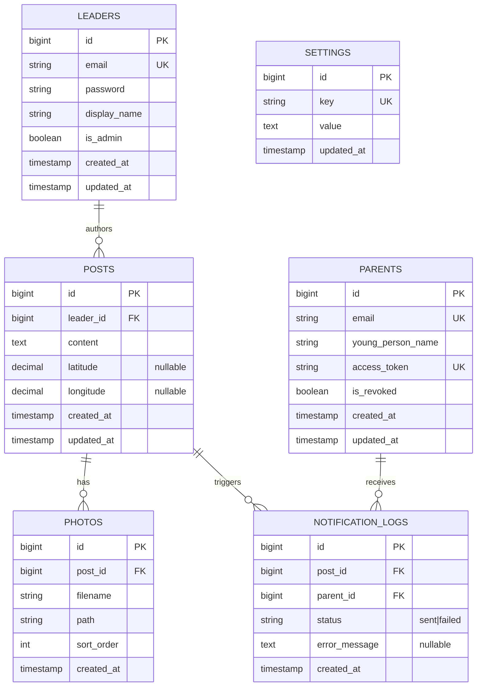

# Design Document: Parent Notifier Portal

## Overview

The Parent Notifier Portal is a server-rendered Laravel application that enables Scout expedition leaders to post updates (text, photos, map pins) to a shared feed. Parents access the feed via unique token URLs and receive email notifications when new posts are published.

The application is architected for shared cPanel hosting with no SSH access, no background queue workers, and FTP-based deployment. All operations are synchronous, photos are stored on the local filesystem, and the database is MySQL provisioned through cPanel.

### Key Design Decisions

| Decision | Choice | Rationale |
|----------|--------|-----------|
| Framework | Laravel (latest stable) | Mature ecosystem, built-in auth, mail, validation, ORM |
| Views | Blade templates + Tailwind CSS | Server-rendered, no JS build complexity required at runtime |
| Maps | Leaflet.js with OpenStreetMap tiles | Free, no API key, lightweight |
| Email | Laravel Mail (synchronous) | No queue workers on shared hosting |
| File storage | Local filesystem (`storage/app/public`) | cPanel-compatible, symlinked to public |
| Auth | Laravel Breeze (Blade) | Minimal scaffolding, Blade-native, no SPA dependencies |
| Database | MySQL 5.7+ | cPanel standard, well-supported by Eloquent |
| Deployment | FTP / cPanel File Manager | No SSH required |

## Architecture



### Request Flow

1. **Parent access**: Parent clicks token link → `TokenAuthMiddleware` validates token → `FeedController` renders feed
2. **Leader access**: Leader visits dashboard → `auth` middleware checks session → `DashboardController` renders pages
3. **Post creation**: Leader submits form → `PostController@store` validates → saves post → uploads photos → sends emails synchronously → redirects with success flash
4. **Email dispatch**: `NotificationService` iterates over active parents, sends mail one-by-one via `Mail::send()`, logs failures, continues to next

### Middleware Stack

| Middleware | Purpose | Applied To |
|-----------|---------|------------|
| `auth` (Laravel built-in) | Session-based leader authentication | All `/dashboard/*` routes |
| `throttle:login` | Rate limiting (5 attempts / 15 min per email) | `/login` POST route |
| `TokenAuthMiddleware` | Validates parent access token from URL | `/feed/{token}` routes |

## Components and Interfaces

### Controllers

```
App\Http\Controllers\
├── Auth\
│   └── LoginController          # Leader login/logout (Breeze scaffolded)
├── DashboardController          # Dashboard home, settings
├── PostController               # CRUD for posts (leader-facing)
├── PhotoController              # Photo upload/delete helpers
├── ParentController             # Parent list management (leader-facing)
├── LeaderController             # Leader account management (admin only)
├── FeedController               # Parent-facing feed display
├── SignUpController              # Parent self-registration
└── PageController               # Static pages (landing, privacy policy, errors)
```

### Services

```
App\Services\
├── PostService                  # Post creation/update orchestration
├── NotificationService          # Synchronous email dispatch to all parents
├── PhotoService                 # Photo upload, resize, delete
├── TokenService                 # Access token generation and validation
└── SignUpService                 # Parent registration logic
```

### Key Interfaces

**PostService**
```php
class PostService
{
    public function create(array $data, Leader $author): Post;
    public function update(Post $post, array $data): Post;
    public function delete(Post $post): void;
}
```

**NotificationService**
```php
class NotificationService
{
    /**
     * Sends email to all active parents synchronously.
     * Logs failures and continues to next parent.
     * Returns count of successful/failed sends.
     */
    public function notifyAllParents(Post $post): NotificationResult;
}
```

**TokenService**
```php
class TokenService
{
    /** Generates a 32+ character URL-safe random token */
    public function generate(): string;

    /** Validates token exists and is not revoked */
    public function validate(string $token): ?Parent;

    /** Revokes a parent's token */
    public function revoke(Parent $parent): void;
}
```

**PhotoService**
```php
class PhotoService
{
    /**
     * Validates and stores photos to local filesystem.
     * Returns array of Photo models.
     */
    public function upload(array $files, Post $post): array;

    /** Removes photo file and database record */
    public function delete(Photo $photo): void;
}
```

### Blade View Structure

```
resources/views/
├── layouts/
│   ├── app.blade.php            # Leader dashboard layout
│   └── feed.blade.php           # Parent feed layout
├── auth/
│   └── login.blade.php
├── dashboard/
│   ├── index.blade.php          # Dashboard home
│   ├── posts/
│   │   ├── create.blade.php
│   │   ├── edit.blade.php
│   │   └── index.blade.php
│   ├── parents/
│   │   └── index.blade.php
│   ├── leaders/
│   │   └── index.blade.php
│   └── settings.blade.php
├── feed/
│   ├── index.blade.php          # Main feed view
│   ├── _post.blade.php          # Post partial
│   └── map.blade.php            # Combined map view
├── signup/
│   └── form.blade.php
├── pages/
│   ├── landing.blade.php
│   └── privacy.blade.php
├── emails/
│   └── new-post.blade.php       # Email notification template
└── errors/
    ├── 403.blade.php
    ├── 404.blade.php
    └── 500.blade.php
```

## Data Models

### Entity Relationship Diagram



### Eloquent Models

| Model | Table | Key Relationships |
|-------|-------|-------------------|
| `Leader` | `leaders` | hasMany Posts |
| `Post` | `posts` | belongsTo Leader, hasMany Photos, hasMany NotificationLogs |
| `Photo` | `photos` | belongsTo Post |
| `Parent_` | `parents` | hasMany NotificationLogs |
| `NotificationLog` | `notification_logs` | belongsTo Post, belongsTo Parent_ |
| `Setting` | `settings` | — |

> Note: The model is named `Parent_` (with trailing underscore) because `Parent` is a PHP reserved keyword in some contexts. Alternatively, use `Guardian` as the model name.

### Key Database Constraints

- `leaders.email` — unique index
- `parents.email` — unique index
- `parents.access_token` — unique index, minimum 32 characters
- `posts.content` — TEXT type, validated 1–5000 chars at application level
- `posts.latitude` / `posts.longitude` — DECIMAL(10,7), nullable
- `photos.post_id` — foreign key with CASCADE delete
- `notification_logs.post_id` — foreign key with CASCADE delete
- `notification_logs.parent_id` — foreign key with SET NULL on delete

### Settings Table Keys

| Key | Default | Purpose |
|-----|---------|---------|
| `signup_enabled` | `"0"` | Controls whether the sign-up link is active |
| `portal_name` | `"Expedition Updates"` | Display name used in emails and headers |


## Correctness Properties

*A property is a characteristic or behavior that should hold true across all valid executions of a system — essentially, a formal statement about what the system should do. Properties serve as the bridge between human-readable specifications and machine-verifiable correctness guarantees.*

### Property 1: Token generation invariants

*For any* generated Access_Token, the token SHALL be at least 32 characters long, consist exclusively of URL-safe alphanumeric characters (a-z, A-Z, 0-9, hyphen, underscore), and no two consecutively generated tokens shall share a common prefix of more than 4 characters.

**Validates: Requirements 3.5**

### Property 2: Token access control

*For any* Access_Token string, if the token matches an active (non-revoked) parent record, the feed SHALL be accessible; if the token does not match any active record (invalid or revoked), the system SHALL return a 403 response.

**Validates: Requirements 3.1, 3.2**

### Property 3: Post content validation

*For any* string submitted as post content, if the string is empty (length 0) or whitespace-only, or exceeds 5000 characters, the system SHALL reject the submission; if the string is between 1 and 5000 non-whitespace-trimmed characters, the system SHALL accept it.

**Validates: Requirements 2.7**

### Property 4: Post creation preserves data

*For any* valid post content and optional latitude/longitude pair, creating a post SHALL store the exact content text, the authoring leader's display name, a creation timestamp, and (if provided) the coordinates with at least 5 decimal places of precision.

**Validates: Requirements 2.1, 2.3**

### Property 5: Edit preserves creation timestamp

*For any* existing post, when the post's content, photos, or map pin is updated, the original `created_at` timestamp SHALL remain unchanged.

**Validates: Requirements 2.5**

### Property 6: Delete cascades to photos

*For any* post with N associated photos (0 ≤ N ≤ 10), deleting the post SHALL remove the post record and all N photo records from the database, and delete the corresponding N files from the filesystem.

**Validates: Requirements 2.6**

### Property 7: Feed ordering and pagination

*For any* collection of posts, the feed SHALL display posts in strictly descending order of creation timestamp, and for any page of results, the number of posts displayed SHALL be at most 20.

**Validates: Requirements 2.4, 4.1, 4.6**

### Property 8: Email recipient filtering

*For any* set of registered parents where some have active tokens and some have revoked tokens, publishing a new post SHALL send notification emails to exactly those parents whose `is_revoked` field is false, and to no others.

**Validates: Requirements 5.1, 6.7**

### Property 9: Email content correctness

*For any* post with text content of length L and any parent with a given access token, the notification email SHALL: (a) contain the post text truncated to 500 characters with "..." appended if L > 500, or the full text if L ≤ 500; (b) contain the parent's personal access token URL; (c) include the posting leader's display name in the subject line.

**Validates: Requirements 5.2, 5.4, 5.5**

### Property 10: Email resilience

*For any* ordered list of N active parents, if sending an email to parent at position K (1 ≤ K < N) fails, the system SHALL still attempt to send emails to all parents at positions K+1 through N, and SHALL log the failure for parent K.

**Validates: Requirements 5.3**

### Property 11: Parent registration produces unique token

*For any* valid email and young person's name (whether submitted via sign-up form or added manually by a leader), registering the parent SHALL create a record with the provided email, the young person's name, and a newly generated unique Access_Token.

**Validates: Requirements 6.4, 6.8**

### Property 12: Duplicate email rejection

*For any* email address that is already registered in the parents table, attempting to register a new parent with that same email SHALL be rejected without creating a duplicate record.

**Validates: Requirements 6.5**

### Property 13: Token revocation blocks access

*For any* parent whose record has been revoked (removed by a leader), subsequent attempts to access the feed using that parent's Access_Token SHALL return a 403 response.

**Validates: Requirements 6.7**

## Error Handling

### Strategy

The application uses a layered error handling approach:

| Layer | Mechanism | Behavior |
|-------|-----------|----------|
| Request validation | Laravel Form Requests | Returns 422 with field-specific error messages |
| Authentication | `auth` middleware | Redirects to login with intended URL |
| Authorization | `TokenAuthMiddleware` | Returns 403 for invalid/revoked tokens |
| File uploads | PhotoService validation | Returns error before file is stored |
| Email dispatch | try/catch per parent | Logs failure, continues to next parent |
| Unhandled exceptions | Laravel exception handler | Logs full trace, renders generic 500 page |

### Specific Error Scenarios

**Post creation with email failures:**
```
1. Validate post content + photos → fail fast on validation errors
2. Save post to database (transaction)
3. Upload photos to filesystem
4. Send emails synchronously in loop:
   - For each active parent:
     - try: send email
     - catch: log to notification_logs with status='failed', continue
5. Redirect with success flash (even if some emails failed)
```

**Photo upload failures:**
- File too large → reject at validation, no file written
- Invalid type → reject at validation, no file written
- Disk write failure → catch IOException, return 500 error, rollback post creation

**Token access errors:**
- Token not found → 403 page ("link is invalid or access has been revoked")
- Token found but revoked → same 403 page (no information leakage about token existence)

### Logging

- Email failures: `notification_logs` table with `status=failed`, `error_message`
- Application errors: Laravel's default log channel (`storage/logs/laravel.log`)
- Authentication failures: Laravel's built-in throttle logging

### User-Facing Error Pages

| HTTP Status | Trigger | Message |
|-------------|---------|---------|
| 403 | Invalid/revoked token, unauthorized access | "Access denied. This link may be invalid or has been revoked." |
| 404 | Non-existent route | "Page not found. Please check the URL." |
| 422 | Validation failure | Field-specific errors displayed in form |
| 500 | Unhandled exception | "Something went wrong. Please try again later." |

## Testing Strategy

### Approach

The testing strategy uses a dual approach combining unit/feature tests for specific scenarios with property-based tests for universal correctness guarantees.

### Property-Based Testing

**Library:** [PHPUnit with `spatie/phpunit-snapshot-assertions`](https://github.com/spatie/phpunit-snapshot-assertions) for snapshot tests, and **[`innmind/black-box`](https://github.com/Innmind/BlackBox)** for property-based testing in PHP.

**Configuration:**
- Minimum 100 iterations per property test
- Each property test tagged with: `Feature: parent-notifier-portal, Property {N}: {title}`

**Property tests to implement:**
1. Token generation invariants (length, character set, non-sequential)
2. Token access control (valid → allowed, invalid/revoked → 403)
3. Post content validation (boundary testing around 0, 1, 5000, 5001 chars)
4. Post data preservation (content, author, timestamp, coordinates)
5. Edit timestamp preservation
6. Cascade deletion
7. Feed ordering and pagination bounds
8. Email recipient filtering (active vs revoked)
9. Email content truncation and inclusion
10. Email resilience (partial failure continues)
11. Registration token uniqueness
12. Duplicate email rejection
13. Token revocation blocks access

### Unit / Feature Tests

**Framework:** PHPUnit + Laravel's testing helpers (`TestCase`, `RefreshDatabase`)

**Key test areas:**
- **Auth flow**: Login, logout, session expiry, rate limiting, redirect-after-login
- **Post CRUD**: Create, edit, delete with various content lengths and photo counts
- **Photo validation**: File type and size boundary tests
- **Feed rendering**: Correct data displayed, pagination controls
- **Sign-up flow**: Enable/disable toggle, form submission, duplicate detection
- **Leader management**: Admin creates/removes leaders, profile updates
- **Error pages**: 404, 403, 500 render correctly without leaking data
- **Privacy policy**: Page exists and is publicly accessible

### Integration Tests

- **Email delivery**: Verify `Mail::fake()` captures correct recipients, subjects, and body content
- **File storage**: Verify photos saved to and deleted from `storage/app/public`
- **Database constraints**: Verify unique indexes, cascade deletes, foreign keys

### Test Organization

```
tests/
├── Unit/
│   ├── Services/
│   │   ├── TokenServiceTest.php
│   │   ├── NotificationServiceTest.php
│   │   └── PhotoServiceTest.php
│   └── Models/
│       └── PostTest.php
├── Feature/
│   ├── Auth/
│   │   └── LoginTest.php
│   ├── Posts/
│   │   ├── CreatePostTest.php
│   │   ├── EditPostTest.php
│   │   └── DeletePostTest.php
│   ├── Feed/
│   │   └── FeedAccessTest.php
│   ├── Parents/
│   │   ├── SignUpTest.php
│   │   └── ManageParentsTest.php
│   └── Leaders/
│       └── ManageLeadersTest.php
└── Property/
    ├── TokenGenerationPropertyTest.php
    ├── TokenAccessPropertyTest.php
    ├── PostValidationPropertyTest.php
    ├── PostDataPropertyTest.php
    ├── FeedOrderingPropertyTest.php
    ├── EmailRecipientPropertyTest.php
    ├── EmailContentPropertyTest.php
    ├── EmailResiliencePropertyTest.php
    ├── RegistrationPropertyTest.php
    └── DuplicateEmailPropertyTest.php
```

### Running Tests

```bash
# All tests
php artisan test

# Property tests only
php artisan test --testsuite=Property

# Feature tests only
php artisan test --testsuite=Feature
```
