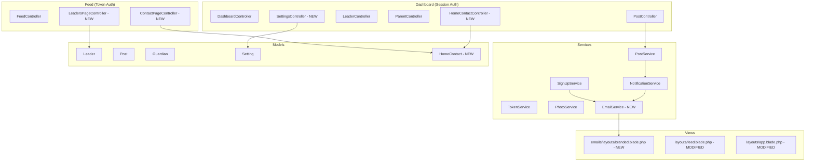

# Design Document: Portal Enhancements

## Overview

This design extends the existing Parent Notifier Portal (Laravel 13.x) with Scouting UK purple branding, welcome emails, improved post creation UX, leader profiles, a home contact schedule, and branded email templates. The enhancements are additive — they modify existing Blade templates, Eloquent models, services, and controllers without replacing the current architecture.

All changes follow the established patterns: Blade views with Tailwind CSS, service-layer business logic, Eloquent models with migrations, and synchronous email delivery via Laravel Mail.

## Architecture

The existing architecture remains unchanged at the structural level:



### Key Architectural Decisions

1. **New `EmailService`** wraps email sending with logging for both welcome and notification emails, replacing direct `Mail::send()` calls in services.
2. **New `HomeContact` model** with its own controller rather than extending an existing controller — clean separation of concerns.
3. **Feed navigation** is extended with Leaders and Contact pages, added to the feed layout rather than creating a separate navigation component.
4. **Settings split** — The existing `LeaderController::settings()` is kept for backward compatibility but a dedicated `SettingsController` handles portal-level settings (logo, portal name, signup link token).
5. **Single pinned post invariant** enforced at the service layer (PostService) rather than database constraints, since MySQL doesn't support partial unique indexes natively.

## Components and Interfaces

### New Model: HomeContact

```php
class HomeContact extends Model
{
    protected $table = 'home_contacts';

    protected $fillable = [
        'leader_id',
        'date',
        'phone_number',
        'notes',
    ];

    protected function casts(): array
    {
        return [
            'date' => 'date',
        ];
    }

    public function leader(): BelongsTo
    {
        return $this->belongsTo(Leader::class);
    }
}
```

### Modified Model: Leader (additional fillable fields)

```php
// Added to $fillable:
'role',          // max 100 chars
'bio',           // max 1000 chars
'phone_number',  // max 20 chars
'profile_photo', // file path string
```

Relationship added:
```php
public function homeContacts(): HasMany
{
    return $this->hasMany(HomeContact::class);
}
```

### Modified Model: Post (additional fields)

```php
// Added to $fillable:
'title',     // nullable, max 200 chars
'is_pinned', // boolean, default false
```

### New Mailable: WelcomeEmail

```php
class WelcomeEmail extends Mailable
{
    public function __construct(
        public Guardian $parent,
        public string $portalName,
        public string $feedUrl,
        public ?string $logoUrl,
    ) {}

    public function content(): Content
    {
        return new Content(
            view: 'emails.welcome',
        );
    }
}
```

### New Service: EmailService

```php
class EmailService
{
    /**
     * Send a welcome email to a newly registered parent.
     * Logs failure but does not throw — registration continues.
     */
    public function sendWelcomeEmail(Guardian $parent): void;

    /**
     * Send post notification to all active parents.
     * Delegates to existing NotificationService pattern.
     */
    public function sendPostNotification(Post $post): NotificationResult;
}
```

### New Controller: HomeContactController

```php
class HomeContactController extends Controller
{
    public function index(): View;          // List all home contacts (dashboard)
    public function store(Request): RedirectResponse;   // Create entry
    public function update(Request, HomeContact): RedirectResponse; // Edit entry
    public function destroy(HomeContact): RedirectResponse;         // Delete entry
}
```

### New Controller: ContactPageController (Feed-side)

```php
class ContactPageController extends Controller
{
    /**
     * Display today's home contact and the next 7 days schedule.
     */
    public function show(string $token): View;
}
```

### New Controller: LeadersPageController (Feed-side)

```php
class LeadersPageController extends Controller
{
    /**
     * Display all leaders with profiles.
     */
    public function show(string $token): View;
}
```

### Modified Controller: SettingsController (extends existing settings)

Handles portal-level settings:
- Logo upload/removal
- Portal name update
- Leader profile updates (role, bio, phone_number, profile_photo)
- Sign-up link token generation

### Modified PostService

```php
public function create(array $data, Leader $author): Post
{
    // Added: $data['title'], $data['is_pinned'], $data['send_notification']
    // If is_pinned=true, unpin all other posts first
    // If send_notification=false, skip email notification
}
```

### Modified FeedController

```php
public function index(Request $request, string $token): View
{
    // Modified query: pinned post first, then reverse chronological
    $pinnedPost = Post::where('is_pinned', true)->with('photos', 'leader')->first();
    $posts = Post::where('is_pinned', false)
        ->with('photos', 'leader')
        ->orderBy('created_at', 'desc')
        ->paginate(20);
}
```

## Data Models

### Migration: Add columns to `leaders` table

```php
Schema::table('leaders', function (Blueprint $table) {
    $table->string('role', 100)->nullable()->after('is_admin');
    $table->text('bio')->nullable()->after('role');           // max 1000 enforced in validation
    $table->string('phone_number', 20)->nullable()->after('bio');
    $table->string('profile_photo')->nullable()->after('phone_number');
});
```

### Migration: Add columns to `posts` table

```php
Schema::table('posts', function (Blueprint $table) {
    $table->string('title', 200)->nullable()->after('leader_id');
    $table->boolean('is_pinned')->default(false)->after('longitude');
});
```

### Migration: Create `home_contacts` table

```php
Schema::create('home_contacts', function (Blueprint $table) {
    $table->id();
    $table->foreignId('leader_id')->constrained('leaders')->nullOnDelete();
    $table->date('date');
    $table->string('phone_number', 20);
    $table->string('notes', 500)->nullable();
    $table->timestamps();

    $table->index('date');
    $table->unique(['leader_id', 'date']);
});
```

Note: `nullOnDelete()` on leader_id allows HomeContact records to survive leader deletion. The leader's display_name should be cached in the view or a `leader_name` column added. Decision: use `nullOnDelete()` with a `leader_name` fallback column.

**Revised**: Add `leader_name` column for historical preservation:

```php
Schema::create('home_contacts', function (Blueprint $table) {
    $table->id();
    $table->foreignId('leader_id')->nullable()->constrained('leaders')->nullOnDelete();
    $table->string('leader_name', 255); // Preserved on creation for historical reference
    $table->date('date');
    $table->string('phone_number', 20);
    $table->string('notes', 500)->nullable();
    $table->timestamps();

    $table->index('date');
});
```

### Migration: Add `signup_link_token` to settings

This is handled via the existing key-value `settings` table — no schema change needed. The key `signup_link_token` will be stored as a row with `key = 'signup_link_token'` and `value = '<generated_token>'`.

### Settings keys used

| Key | Purpose |
|-----|---------|
| `portal_name` | Configurable portal display name |
| `logo_path` | Relative path to uploaded logo file |
| `signup_enabled` | "1" or "0" toggle |
| `signup_link_token` | Unique token for the sign-up URL |

### Route additions

```php
// Feed routes (token auth)
Route::get('/feed/{token}/leaders', [LeadersPageController::class, 'show'])->name('feed.leaders');
Route::get('/feed/{token}/contact', [ContactPageController::class, 'show'])->name('feed.contact');

// Dashboard routes (session auth)
Route::resource('home-contacts', HomeContactController::class)->except(['show']);
Route::post('/settings/logo', [SettingsController::class, 'uploadLogo'])->name('settings.upload-logo');
Route::delete('/settings/logo', [SettingsController::class, 'removeLogo'])->name('settings.remove-logo');
Route::post('/settings/portal-name', [SettingsController::class, 'updatePortalName'])->name('settings.update-portal-name');
Route::post('/settings/profile', [SettingsController::class, 'updateProfile'])->name('settings.update-profile');
```

## Correctness Properties

*A property is a characteristic or behavior that should hold true across all valid executions of a system — essentially, a formal statement about what the system should do. Properties serve as the bridge between human-readable specifications and machine-verifiable correctness guarantees.*

### Property 1: Pin invariant and feed ordering

*For any* set of posts and any pin operation, after pinning a post, exactly one post in the database SHALL have `is_pinned = true`, AND querying the feed SHALL return the pinned post before all non-pinned posts regardless of creation timestamp.

**Validates: Requirements 3.7, 3.8**

### Property 2: Notification suppression

*For any* valid post data where `send_notification` is set to `false`, creating that post SHALL result in zero emails being dispatched while the post is still persisted to the database.

**Validates: Requirements 3.6**

### Property 3: Contact page date filtering

*For any* set of HomeContact records and any reference date treated as "today", the Contact Page query SHALL return only records where the date equals today or falls within the next 7 calendar days, ordered by date ascending.

**Validates: Requirements 5.3**

### Property 4: Home contact date validation

*For any* date strictly in the past (before today), attempting to create a HomeContact record with that date SHALL fail validation.

**Validates: Requirements 5.6**

### Property 5: Post notification email contains required data

*For any* Post with any non-empty content and any Parent with a valid access token, the rendered new-post notification email SHALL contain the post leader's display name, a substring of the post content, and the parent's access token URL.

**Validates: Requirements 6.3**

### Property 6: Welcome email contains required data

*For any* Parent with a valid access token, the rendered welcome email SHALL contain the portal name and the parent's personal access token URL.

**Validates: Requirements 6.4**

## Error Handling

### File Upload Errors

- **Invalid file type or size**: Laravel validation rules (`mimes:jpeg,png,webp`, `max:2048`) reject before storage. Return validation error to the form with specific message about accepted types and max size.
- **Storage failure**: Catch filesystem exceptions, log error, return generic "upload failed" message.

### Email Sending Errors

- **Welcome email failure**: `EmailService::sendWelcomeEmail()` catches all `Throwable`, logs the parent email + error reason to `notification_logs` with status `failed` and type `welcome`. Registration proceeds.
- **Post notification failure**: Existing pattern preserved — individual failures are logged per-parent, sending continues to remaining parents.

### Home Contact Validation Errors

- **Past date**: Validation rule `after_or_equal:today` rejects creation of entries for past dates.
- **Invalid leader_id**: Foreign key constraint + `exists:leaders,id` validation rule.
- **Duplicate leader+date**: Unique constraint on `[leader_id, date]` catches at DB level; validation rule `unique:home_contacts,date,...,leader_id,...` catches at form level.

### Deleted Leader References

- HomeContact records with `leader_id = null` (after leader deletion) use the preserved `leader_name` column for display.
- Posts by deleted leaders remain in the feed — the `leader` relationship returns null, views show "Former Leader" fallback text.

## Testing Strategy

### Property-Based Tests (PHPUnit + custom data providers)

Since PHP doesn't have a mainstream PBT library with shrinking comparable to QuickCheck, we'll use PHPUnit's `@dataProvider` methods with randomized data generation to approximate property-based testing. Each property test will run with at minimum 100 generated inputs.

**Library**: PHPUnit with custom `DataProvider` trait generating random test data  
**Configuration**: Each property test uses a data provider generating 100+ random cases  
**Tag format**: `@group pbt` and comment referencing the property

Tests to implement:
- Property 1: Generate random sets of posts, apply pin operations, verify invariant
- Property 2: Generate random post data with `send_notification=false`, verify no mail sent
- Property 3: Generate random HomeContact date sets, vary "today", verify filtering
- Property 4: Generate random past dates, verify validation failure
- Property 5: Generate random post content and parent tokens, verify email rendering
- Property 6: Generate random parent records, verify welcome email rendering

### Unit Tests (Example-based)

- Logo upload with valid/invalid files
- Leader profile CRUD operations
- Post creation with title, pin toggle, notification toggle
- HomeContact CRUD operations
- Sign-up link token regeneration on enable/disable cycle
- Feed ordering with pinned post
- Contact page with no scheduled contact for today
- Leaders page rendering with/without profile photos

### Integration Tests

- Full post creation flow: form submission → database → email (with Mail::fake())
- Parent sign-up flow: form submission → Guardian created → welcome email sent
- Settings update flow: logo upload → stored → appears in header and emails
- Home contact schedule: create entries → verify feed contact page shows correct entries

### What We Don't Property-Test

- CSS colour values and visual styling (smoke/manual tests)
- Blade template structure and layout (example-based feature tests)
- File storage mechanics (integration tests with Storage::fake())
- Authentication and authorization (example-based tests)
