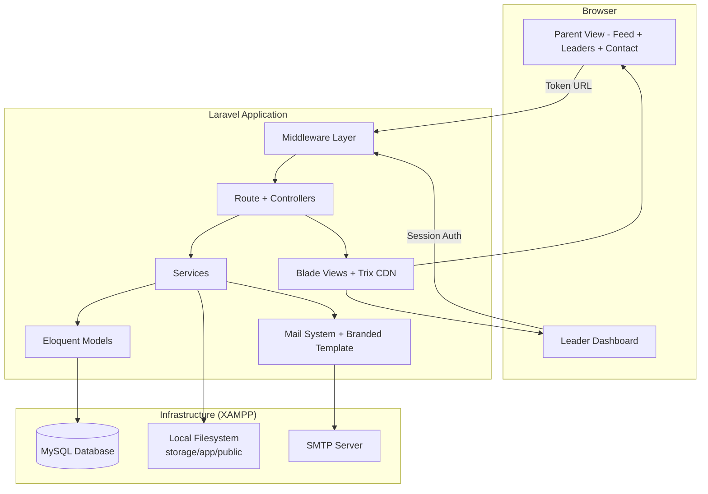
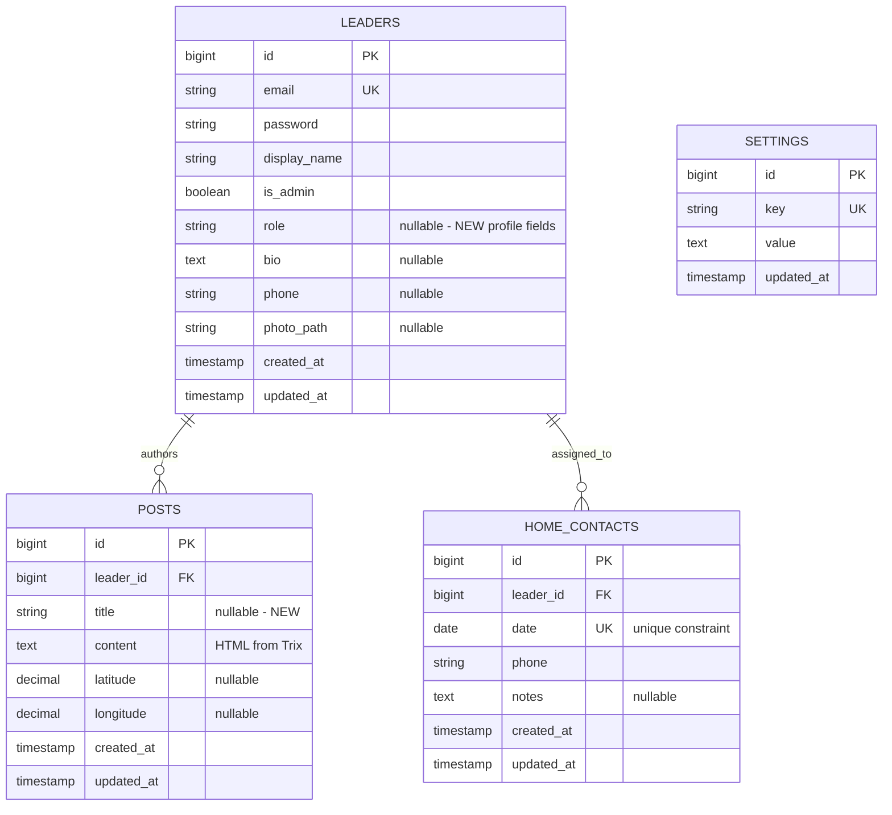

# Design Document: Scouting Portal Enhancements

## Overview

This design covers seven enhancements to the existing Parent Notifier Portal: purple branding, welcome emails, rotating sign-up tokens, improved post creation (Trix editor + title + notification toggle), public-facing leader profiles, home contact schedule, and a shared branded email template. All changes maintain the existing architectural constraints: synchronous email, local filesystem storage, XAMPP/MySQL, no queue workers.

### Key Design Decisions

| Decision | Choice | Rationale |
|----------|--------|-----------|
| Rich text editor | Trix (CDN) | No npm build step needed, produces clean HTML, Basecamp-maintained |
| Post title | Nullable varchar(255) on `posts` table | Backwards-compatible with existing posts |
| Email template | Shared Blade layout `emails/layouts/branded.blade.php` | Single source of truth for branding in all emails |
| Notification control | `send_notification` boolean param to `PostService::create()` | Clean service interface, controller handles UI toggle |
| Sign-up token | Settings row `signup_token` (varchar) | Simple, no new table needed, rotates on enable |
| Logo storage | `portal_logo_path` in settings, file in `storage/app/public/branding/` | Consistent with existing photo storage pattern |
| New parent-facing pages | Token-authenticated routes under `/feed/{token}/` | Reuses existing `TokenAuthMiddleware` |
| Home contact CRUD | New `HomeContactController` under Dashboard | Separates concerns from existing LeaderController |
| Leader profiles (parent view) | New `LeaderProfileController` for feed routes | Keeps feed-facing logic separate from admin |

## Architecture



### New Routes

```
# Token-authenticated parent-facing routes (added)
GET  /signup/{token}              → SignUpController@show (replaces /signup)
POST /signup/{token}              → SignUpController@store
GET  /feed/{token}/leaders        → LeaderProfileController@index
GET  /feed/{token}/contact        → HomeContactController@show

# Dashboard routes (added)
GET  /dashboard/home-contacts              → HomeContactController@index
POST /dashboard/home-contacts              → HomeContactController@store
PUT  /dashboard/home-contacts/{contact}    → HomeContactController@update
DELETE /dashboard/home-contacts/{contact}  → HomeContactController@destroy
POST /dashboard/settings/branding          → SettingsController@updateBranding
POST /dashboard/settings/profile           → LeaderController@updateProfile (extended)
```

## Components and Interfaces

### New Controllers

```
App\Http\Controllers\
├── HomeContactController        # CRUD for home contacts (leader dashboard) + parent-facing show
├── LeaderProfileController      # Parent-facing "Meet the Leaders" page
├── SettingsController           # Branding settings (logo, subtitle)
└── SignUpController             # Refactored: token-based sign-up routing
```

### Modified Controllers

- **PostController** — Add `title` field, `send_notification` toggle, Trix content handling
- **LeaderController** — Extend `updateProfile()` to handle role, bio, phone, photo_path
- **ParentController** — `toggleSignup()` now generates/clears `signup_token` in settings
- **FeedController** — Pass links to leaders/contact pages to feed view

### Service Changes

**PostService** (modified)

```php
class PostService
{
    /**
     * Create a new post with optional title, photos, and conditional notification.
     *
     * @param array $data Keys: 'title' (nullable), 'content' (required HTML),
     *                     'latitude', 'longitude', 'photos', 'send_notification'
     * @param Leader $author
     * @return Post
     */
    public function create(array $data, Leader $author): Post
    {
        $this->validateTitle($data['title'] ?? null);
        $this->validateContent($data['content'] ?? '');

        $post = Post::create([
            'leader_id' => $author->id,
            'title' => $data['title'] ?? null,
            'content' => $data['content'],
            'latitude' => $data['latitude'] ?? null,
            'longitude' => $data['longitude'] ?? null,
        ]);

        if (!empty($data['photos'])) {
            $this->photoService->upload($data['photos'], $post);
        }

        // Only send notifications if toggle is ON (defaults true)
        $sendNotification = $data['send_notification'] ?? true;
        if ($sendNotification) {
            $this->notificationService->notifyAllParents($post);
        }

        return $post;
    }
}
```

**SignUpService** (modified)

```php
class SignUpService
{
    /**
     * Register a new parent and send welcome email.
     * Email failures are logged but do not interrupt registration.
     */
    public function register(string $email, string $youngPersonName): Guardian
    {
        if (Guardian::where('email', $email)->exists()) {
            throw ValidationException::withMessages([
                'email' => ['A parent with this email address is already registered.'],
            ]);
        }

        $token = $this->tokenService->generate();

        $guardian = Guardian::create([
            'email' => $email,
            'young_person_name' => $youngPersonName,
            'access_token' => $token,
            'is_revoked' => false,
        ]);

        $this->sendWelcomeEmail($guardian);

        return $guardian;
    }

    /**
     * Send welcome email, logging failure without interrupting flow.
     */
    protected function sendWelcomeEmail(Guardian $guardian): void
    {
        try {
            Mail::to($guardian->email)->send(new WelcomeEmail($guardian));
        } catch (Throwable $e) {
            Log::error('Welcome email failed', [
                'email' => $guardian->email,
                'error' => $e->getMessage(),
            ]);
        }
    }
}
```

**HomeContactService** (new)

```php
class HomeContactService
{
    /**
     * Create a home contact entry. Rejects if date already assigned.
     */
    public function create(array $data): HomeContact
    {
        if (HomeContact::where('date', $data['date'])->exists()) {
            throw ValidationException::withMessages([
                'date' => ['A home contact is already assigned for this date.'],
            ]);
        }

        return HomeContact::create($data);
    }

    /**
     * Update an existing home contact entry.
     * Rejects if changing to a date that already has an assignment.
     */
    public function update(HomeContact $contact, array $data): HomeContact
    {
        if (isset($data['date']) && $data['date'] !== $contact->date->format('Y-m-d')) {
            if (HomeContact::where('date', $data['date'])->exists()) {
                throw ValidationException::withMessages([
                    'date' => ['A home contact is already assigned for this date.'],
                ]);
            }
        }

        $contact->update($data);
        return $contact->refresh();
    }

    /**
     * Delete a home contact entry.
     */
    public function delete(HomeContact $contact): void
    {
        $contact->delete();
    }

    /**
     * Get today's home contact (or null).
     */
    public function getToday(): ?HomeContact
    {
        return HomeContact::with('leader')
            ->where('date', today())
            ->first();
    }

    /**
     * Get upcoming home contacts for the next 7 days (excluding today).
     */
    public function getUpcoming(): Collection
    {
        return HomeContact::with('leader')
            ->where('date', '>', today())
            ->where('date', '<=', today()->addDays(7))
            ->orderBy('date')
            ->get();
    }
}
```

### New Mailables

**WelcomeEmail** (new)

```php
class WelcomeEmail extends Mailable
{
    public string $feedUrl;
    public string $portalName;

    public function __construct(public Guardian $guardian)
    {
        $this->feedUrl = url('/feed/' . $this->guardian->access_token);
        $this->portalName = Setting::where('key', 'portal_name')->value('value')
            ?? 'Expedition Updates';
    }

    public function envelope(): Envelope
    {
        return new Envelope(
            subject: "Welcome to {$this->portalName}",
        );
    }

    public function content(): Content
    {
        return new Content(
            view: 'emails.welcome',
            with: [
                'guardian' => $this->guardian,
                'feedUrl' => $this->feedUrl,
                'portalName' => $this->portalName,
            ],
        );
    }
}
```

**NewPostNotification** (modified) — Updated to use branded layout:

```php
public function content(): Content
{
    return new Content(
        view: 'emails.new-post',  // Now extends emails.layouts.branded
        with: [
            'post' => $this->post,
            'parent' => $this->parent,
            'truncatedContent' => $this->truncatedContent,
            'feedUrl' => $this->feedUrl,
            'portalName' => $this->portalName,
            'leaderName' => $this->leaderName,
        ],
    );
}
```

### Blade View Changes

```
resources/views/
├── layouts/
│   ├── app.blade.php            # Updated: purple branding, logo, subtitle
│   └── feed.blade.php           # Updated: purple branding, logo, subtitle, leader/contact links
├── dashboard/
│   ├── posts/
│   │   ├── create.blade.php     # Updated: title field, Trix editor, notification toggle, sidebar
│   │   └── edit.blade.php       # Updated: title field, Trix editor
│   ├── home-contacts/
│   │   └── index.blade.php      # NEW: home contact schedule CRUD
│   ├── settings.blade.php       # Updated: logo upload, subtitle field, profile photo/bio/role/phone
│   └── parents/
│       └── index.blade.php      # Updated: shows signup URL with token or "closed" message
├── feed/
│   ├── index.blade.php          # Updated: renders post titles, HTML content, leader/contact links
│   ├── leaders.blade.php        # NEW: "Meet the Leaders" page
│   └── contact.blade.php        # NEW: Home contact page for parents
├── signup/
│   └── form.blade.php           # Updated: handles token validation, invalid/expired states
├── emails/
│   ├── layouts/
│   │   └── branded.blade.php    # NEW: shared branded email layout
│   ├── new-post.blade.php       # Updated: extends branded layout
│   └── welcome.blade.php        # NEW: welcome email content
└── components/
    └── header.blade.php         # NEW: shared header component (logo + name + subtitle)
```

### Trix Editor Integration

The Trix editor is loaded via CDN in the post create/edit views:

```html
<!-- In dashboard/posts/create.blade.php and edit.blade.php -->
<link rel="stylesheet" href="https://unpkg.com/trix@2.1.1/dist/trix.css">
<script src="https://unpkg.com/trix@2.1.1/dist/trix.umd.min.js"></script>

<input id="content" type="hidden" name="content" value="{{ old('content', $post->content ?? '') }}">
<trix-editor input="content" class="trix-content prose"></trix-editor>
```

Content is stored as HTML in the `posts.content` TEXT column. On output in the Feed, content is rendered through a whitelist sanitizer allowing only: `<strong>`, `<em>`, `<a>`, `<ul>`, `<ol>`, `<li>`, `<h1>`, `<blockquote>`, `<br>`, `<div>`.

### Branded Email Layout

```blade
{{-- resources/views/emails/layouts/branded.blade.php --}}
<!DOCTYPE html>
<html>
<head><meta charset="utf-8"></head>
<body style="margin:0; padding:0; background:#f4f4f4;">
  <table width="100%" cellpadding="0" cellspacing="0">
    {{-- Purple Header --}}
    <tr>
      <td style="background:#7413DC; padding:24px; text-align:center;">
        @if($logoUrl)
          
        @endif
        <h1 style="color:#ffffff; margin:8px 0 0;">{{ $portalName }}</h1>
      </td>
    </tr>
    {{-- White Content Area --}}
    <tr>
      <td style="background:#ffffff; padding:32px;">
        @yield('content')
      </td>
    </tr>
    {{-- Purple Footer --}}
    <tr>
      <td style="background:#7413DC; padding:16px; text-align:center;">
        <a href="{{ url('/privacy') }}" style="color:#ffffff;">Privacy Policy</a>
      </td>
    </tr>
  </table>
</body>
</html>
```

## Data Models

### Schema Changes (New Migration)

```php
// Migration: add_scouting_enhancements_columns

// Add title to posts table
Schema::table('posts', function (Blueprint $table) {
    $table->string('title', 255)->nullable()->after('leader_id');
});

// Add unique constraint on home_contacts.date
Schema::table('home_contacts', function (Blueprint $table) {
    $table->unique('date');
});
```

### New Settings Keys

| Key | Default | Purpose |
|-----|---------|---------|
| `signup_token` | `null` | Active sign-up token; null when sign-ups disabled |
| `portal_logo_path` | `null` | Relative path to uploaded logo in `storage/app/public/branding/` |
| `portal_subtitle` | `null` | Subtitle text shown beneath portal name |

### Updated Model: Post

```php
class Post extends Model
{
    protected $fillable = [
        'leader_id',
        'title',       // NEW: nullable varchar(255)
        'content',     // Now stores HTML from Trix
        'latitude',
        'longitude',
    ];
}
```

### Entity Relationships (Updates)



## Error Handling

### New Error Scenarios

| Scenario | Handling | User Impact |
|----------|----------|-------------|
| Logo upload invalid type/size | Form Request validation → 422 | Error message with accepted types/size |
| Profile photo invalid type/size | Form Request validation → 422 | Error message with accepted types/size |
| Post title > 255 chars | Form Request validation → 422 | Error message about max length |
| Welcome email fails | try/catch, Log::error(), continue | Parent registered, no email received |
| Invalid signup token in URL | Controller check → view with "invalid/expired" message | Informational page |
| Sign-ups disabled + any token | Controller check → view with "closed" message | Informational page |
| Duplicate home contact date | Service validation → 422 | Error message about date conflict |
| Trix content with script tags | Output sanitization strips unsafe HTML | Clean display |

### HTML Sanitization Strategy

Post content from Trix is stored as-is in the database (HTML). On output in the Feed, the content is passed through a whitelist sanitizer. The allowed tags are:

```php
$allowedTags = ['strong', 'em', 'a', 'ul', 'ol', 'li', 'h1', 'blockquote', 'br', 'div'];
$allowedAttributes = ['a' => ['href']];
```

Implementation uses `strip_tags()` with allowed tags, or a lightweight HTML purifier. Links are sanitized to allow only `http://` and `https://` protocols.

### Sign-Up Token Validation Flow

```
Request to /signup/{token}
  │
  ├── Sign-ups disabled (signup_enabled != '1')?
  │     └── Show "Sign-ups are currently closed" view
  │
  ├── Token matches settings.signup_token?
  │     └── Show sign-up form
  │
  └── Token does NOT match?
        └── Show "This sign-up link is invalid or expired" view
```

## Correctness Properties

*A property is a characteristic or behavior that should hold true across all valid executions of a system — essentially, a formal statement about what the system should do. Properties serve as the bridge between human-readable specifications and machine-verifiable correctness guarantees.*

### Property 1: Image upload validation

*For any* uploaded file that is not of type JPEG, PNG, or WebP, or that exceeds 2 MB in size, the system SHALL reject the upload with a validation error — whether the upload target is the portal logo or a leader profile photo.

**Validates: Requirements 1.5, 5.3**

### Property 2: Welcome email content correctness

*For any* newly registered Parent with a given access token, the welcome email SHALL have a subject line containing the portal name, a body containing the Parent's personal feed URL (including their access token), and a body containing the portal name.

**Validates: Requirements 2.3, 2.4, 2.7**

### Property 3: Welcome email failure resilience

*For any* Parent registration where the welcome email fails to send (mail transport throws an exception), the Parent record SHALL still be successfully created in the database and the failure SHALL be logged with the Parent's email and error reason.

**Validates: Requirements 2.6**

### Property 4: Sign-up token format

*For any* invocation of the sign-up token generation (when a Leader enables sign-ups), the generated token SHALL be at least 32 characters long and consist exclusively of URL-safe alphanumeric characters (a-z, A-Z, 0-9).

**Validates: Requirements 3.1**

### Property 5: Sign-up token access control

*For any* token string submitted to the sign-up URL, if sign-ups are enabled and the token matches the current `signup_token` setting, access to the sign-up form SHALL be granted; if sign-ups are disabled or the token does not match the current setting, access SHALL be denied with an appropriate message.

**Validates: Requirements 3.2, 3.3, 3.4**

### Property 6: Sign-up token rotation invalidation

*For any* sequence of enable → disable → re-enable operations on sign-ups, the token generated on re-enable SHALL be different from the previously generated token, and the previous token SHALL no longer grant access to the sign-up form.

**Validates: Requirements 3.5**

### Property 7: Post title persistence round-trip

*For any* valid title string (1–255 characters), saving a Post with that title SHALL result in the exact same title string being retrievable from the database and displayed in the Feed.

**Validates: Requirements 4.2**

### Property 8: Post HTML content round-trip

*For any* HTML string produced by the Trix editor (containing only whitelisted formatting tags), storing and retrieving the post content SHALL preserve the exact HTML string.

**Validates: Requirements 4.5**

### Property 9: Post HTML sanitization

*For any* HTML content string that contains tags outside the Trix whitelist (e.g., `<script>`, `<iframe>`, `<style>`, ``, `<form>`), rendering the post in the Feed SHALL strip all non-whitelisted tags while preserving the text content and allowed formatting.

**Validates: Requirements 4.6**

### Property 10: Post title length validation

*For any* string exceeding 255 characters submitted as a post title, the system SHALL reject the post submission with a validation error indicating the maximum title length.

**Validates: Requirements 4.12**

### Property 11: Notification toggle controls email dispatch

*For any* post creation where `send_notification` is false, zero email notifications SHALL be sent; where `send_notification` is true, email notifications SHALL be dispatched to all active (non-revoked) Parents.

**Validates: Requirements 4.8, 4.9**
